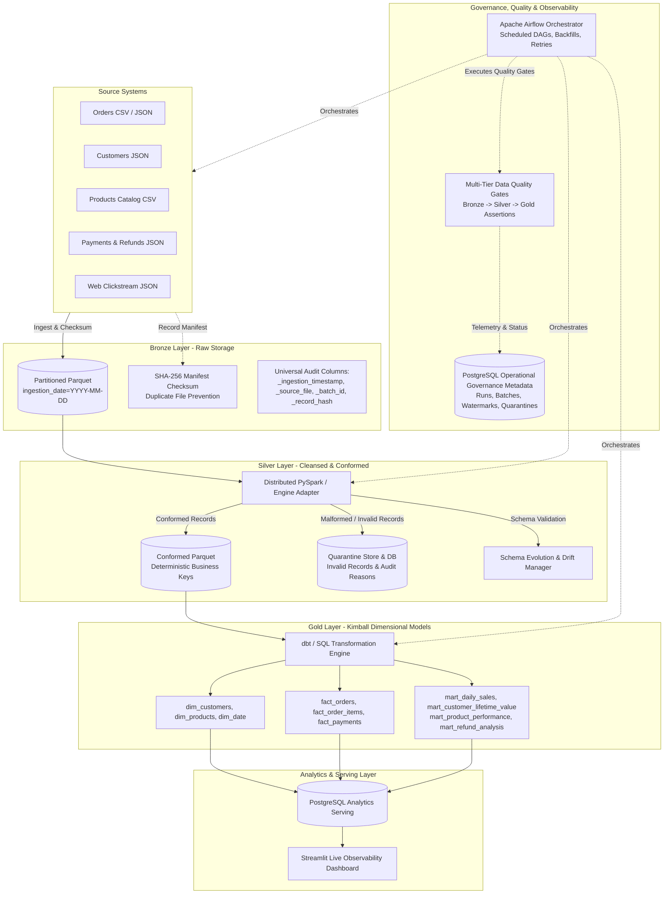

# Production-Style Data Lakehouse & ETL Platform

[](https://github.com/data-eng/production-lakehouse-etl/actions)
[](https://www.python.org/downloads/)
[](https://airflow.apache.org/)
[](https://spark.apache.org/)
[](https://www.getdbt.com/)
[](https://www.postgresql.org/)
[](https://www.docker.com/)
[](https://github.com/astral-sh/ruff)
[](tests/)

An enterprise-grade, containerized **Data Lakehouse and ETL Platform** demonstrating modern data engineering architecture, Kimball dimensional modeling, automated quality gates, stateful watermarking, idempotency guarantees, schema evolution, and real-time operational observability for an e-commerce enterprise.

---

## 1. Executive Summary & Business Problem

Modern e-commerce enterprises generate millions of events daily across disparate operational touchpoints: online store orders, customer identity profiles, warehouse catalog updates, payment processor transactions, refunds, and digital clickstream logs.

### Key Engineering Challenges Solved:
1. **Dirty & Duplicate Data:** Network retries, mobile disconnects, and webhooks lead to duplicate records and out-of-order events. The platform enforces deterministic deduplication rules via distributed PySpark window functions.
2. **Silent Pipeline Corruption:** In bad pipelines, corrupt inputs either break downstream dashboards or silently distort company financials. This platform enforces **Multi-Tier Quality Gates** that halt publishing if critical assertions fail, isolating malformed records in an audited **Quarantine** store.
3. **Pipeline Idempotency & Financial Accuracy:** Pipeline reruns or historical backfills must never double-count revenue or create duplicate records. Total revenue between atomic order line items, fact tables, and aggregate sales marts reconciles to the exact penny.
4. **Schema Drift & Contract Breaks:** Source systems introduce new optional fields or change formats. The platform detects schema drift, allows backward-compatible changes, and halts on breaking changes without dropping data.

---

## 2. End-to-End Medallion Architecture



---

## 3. Technology Stack & Design Decisions

| Technology | Role | Design Rationale |
|:---|:---|:---|
| **Python 3.11** | Core Ingestion & Engine | Modern language features, strict type hinting, robust ecosystem. |
| **Apache Airflow 2.8+** | Orchestration & DAGs | Production scheduling, dynamic DAG generation, stateful backfills, task-level retries. |
| **PySpark 3.4+** | Distributed Transformations | Scalable windowed deduplication, Parquet I/O, schema enforcement across large volumes. |
| **dbt-core 1.7+** | Dimensional Modeling | Modular SQL transformations, version-controlled business logic, automated schema testing. |
| **PostgreSQL 15** | Metadata & Serving | ACID operational metadata repository and high-performance SQL analytical serving. |
| **Parquet** | Storage Format | Highly compressed columnar storage with metadata headers and partition pruning. |
| **DuckDB / PyArrow** | Local Engine Adapter | Ultra-fast local execution enabling zero-infrastructure testing on developer laptops. |
| **Streamlit** | Observability Dashboard | Interactive real-time UI for pipeline runs, quality gate scorecards, and quarantine inspection. |
| **Docker Compose** | Containerization | 100% reproducible local multi-service deployment with healthchecks and persistent volumes. |
| **pytest & Ruff** | Quality & Linting | Comprehensive automated testing suite (43 test cases: 42 passed, 1 environment-skipped) and blazing-fast code formatting. |

---

## 4. Medallion Data Flow Details

### Bronze Layer (Raw Storage)
- **Path:** `data/lakehouse/bronze/<entity>/ingestion_date=YYYY-MM-DD/`
- **Responsibilities:** Preserves raw payloads in partitioned Parquet files with zero destructive transformations.
- **Audit Columns:** Every record is enriched with `_ingestion_timestamp`, `_source_file`, `_batch_id`, and `_record_hash`.
- **Duplicate Prevention:** SHA-256 fingerprinting in `metadata.file_manifests` prevents reprocessing identical input files.

### Silver Layer (Cleansed & Conformed)
- **Path:** `data/lakehouse/silver/<entity>/`
- **Responsibilities:** Standardizes datatypes, normalizes timestamps to UTC, trims text, casts numeric currency.
- **Deterministic Deduplication:**
  ```python
  # PySpark window deduplication by natural key, picking most recent event
  window_spec = Window.partitionBy("order_id").orderBy(col("order_timestamp").desc())
  deduped_df = df.withColumn("row_num", row_number().over(window_spec)).filter(col("row_num") == 1)
  ```
- **Quarantine Isolation:** Records failing primary key uniqueness, nullability, or business range checks are routed to `data/lakehouse/quarantine/<entity>/` and logged in `metadata.quarantined_records`.

### Gold Layer (Dimensional Models & Marts)
- **Path:** `data/lakehouse/gold/<model>/` and PostgreSQL schema `public` / `analytics`.
- **Dimensional Models:**
  - `dim_date`: Enterprise date dimension covering calendar, fiscal quarter, weekend indicators.
  - `dim_customers`: Customer dimension with aggregated lifetime metrics and RFM segmentation.
  - `dim_products`: Product catalog dimension with procurement costs and gross margin percentages.
  - `fact_orders`: Transaction grain fact table linking customer, date, and order totals.
  - `fact_order_items`: Line-item grain fact table linking product, order, and line margins.
  - `fact_payments`: Settlement transaction fact table tracking charges and refunds.
- **Aggregated Analytical Marts:**
  - `mart_daily_sales`: Daily executive summary (gross revenue, completed orders, average order value).
  - `mart_customer_lifetime_value`: Customer cohort value, order frequency, spend tier.
  - `mart_product_performance`: Product-level sales volume, margin generation, velocity.
  - `mart_refund_analysis`: Daily refund rate tracking and net collected settlements.

---

## 5. Automated Data Quality Gates

The platform implements an automated multi-tier quality gate framework (`src/validation/quality_engine.py`):

| Layer | Rule Categories | Severity | Failure Behavior |
|:---|:---|:---|:---|
| **Bronze** | File readability, non-empty batches, JSON/CSV format validation, SHA-256 duplicate file detection | `CRITICAL` | Aborts ingestion batch; logs manifest rejection. |
| **Silver** | Non-null primary keys, valid foreign key references, positive price/amount ranges, standardized status enum values | `CRITICAL` / `WARNING` | Routes bad rows to Quarantine; logs to metadata. |
| **Gold** | Fact-to-dimension referential integrity, financial reconciliation (`fact_orders` revenue == `mart_daily_sales` revenue to the penny), positive margin | `CRITICAL` | **Blocks Gold publishing.** Downstream consumers never receive corrupt aggregates. |

---

## 6. Incremental Processing, Idempotency & Backfills

### Watermark Management
- Incremental extraction uses high-watermark timestamps persisted in `metadata.watermarks`.
- A configurable lookback grace period (default: 30 minutes) captures late-arriving events without scanning entire multi-year histories.
- Watermarks update **only** after a pipeline run successfully completes and quality gates pass.

### Safe Replay & Idempotency Guarantee
Rerunning an ingestion batch or re-executing the transformation pipeline is **completely idempotent**:
- Bronze and Silver partitions are written using deterministic business keys and atomic partition overwrites (`mode("overwrite")` or staging-and-swap).
- Gold tables and analytical marts are refreshed via atomic transactional upserts or partition rebuilds.
- Rerunning the exact same source batch multiple times produces the identical row count and penny-exact financial metrics.

### Historical Backfills
To recompute historical data for a specific date window:
```bash
# Reprocess historical partitions for a selected date range
python scripts/run_backfill.py --start-date 2026-01-01 --end-date 2026-03-31 --entity orders
```
The backfill runner:
1. Re-evaluates raw Bronze partitions in the requested range.
2. Applies current conformance rules and regenerates Silver partitions.
3. Atomically recalculates affected date partitions in `fact_orders` and `mart_daily_sales`.
4. Records execution telemetry to `metadata.backfill_runs`.

---

## 7. Quickstart & Deployment Guide

### Prerequisites
- Python 3.11+
- Docker and Docker Compose (recommended for full multi-service deployment)
- Git

### Option A: Local Development Quickstart (Zero Docker Required)
The platform features an intelligent storage and database adapter that runs entirely locally using DuckDB, PyArrow, and SQLite:

```bash
# 1. Clone the repository
git clone https://github.com/data-eng/production-lakehouse-etl.git
cd production-lakehouse-etl

# 2. Create and activate virtual environment
python -m venv .venv
source .venv/bin/activate  # On Windows: .\.venv\Scripts\Activate.ps1

# 3. Install pinned dependencies
pip install -r requirements.txt

# 4. Generate realistic e-commerce datasets
python scripts/generate_mock_data.py --orders 1500 --customers 300 --products 80

# 5. Run the full Medallion pipeline end-to-end
python scripts/run_pipeline.py --all

# 6. Launch the Streamlit Observability Dashboard
streamlit run dashboard/app.py
```

### Option B: Containerized Multi-Service Deployment (Docker Compose)
Runs PostgreSQL, Apache Airflow Webserver & Scheduler, Spark Lakehouse Worker, and Streamlit Dashboard in Docker containers:

```bash
# 1. Copy environment configuration
cp .env.example .env

# 2. Build and launch all services
docker compose up -d --build

# 3. Initialize Airflow metadata database and admin user
docker compose exec airflow-webserver airflow db migrate
docker compose exec airflow-webserver airflow users create \
    --username airflow \
    --password airflow \
    --firstname Data \
    --lastname Engineer \
    --role Admin \
    --email admin@lakehouse.local

# 4. Access services
# Airflow UI:      http://localhost:8080 (airflow / airflow)
# Streamlit UI:    http://localhost:8501
# PostgreSQL:      localhost:5432 (lakehouse_db)
```

---

## 8. Automated Testing & Verification

The test suite covers unit tests, integration tests, idempotency proofs, backfill execution, Docker configurations, and fault-recovery scenarios across 43 automated test cases (42 passed, 1 environment-skipped):

```bash
# Run the complete test suite
pytest tests/ -v

# Run specific test categories
pytest tests/unit/ -v            # Fast unit tests (watermarks, schemas, rules, Docker config)
pytest tests/integration/ -v     # Storage, transformation, dbt Kimball models, and DB tests
pytest tests/end_to_end/ -v      # End-to-end pipeline, backfills, AST DAG integrity & idempotency
```

### Verified Test Summary:
- `test_watermark_update_and_get`: Verifies checkpoint persistence and lookback windows.
- `test_schema_evolution`: Proves non-breaking column additions pass and breaking removals fail.
- `test_file_manifest_duplicate_detection`: Proves identical files are rejected via SHA-256 fingerprinting.
- `test_raw_ingester`: Proves raw JSON/CSV ingestion into partitioned Bronze Parquet with audit columns.
- `test_silver_conformance_and_deduplication`: Proves window deduplication on dirty and duplicate inputs.
- `test_gold_builder_and_marts`: Proves dimensional models and analytical marts calculate correctly.
- `test_kimball_dimensional_star_schema_and_marts`: Validates surrogate keys, Kimball star schema grains, and foreign key integrity.
- `test_financial_reconciliation_penny_exact`: **Proves that fact_orders revenue reconciles to mart_daily_sales gross revenue to the exact penny ($0.00 variance).**
- `test_pipeline_e2e`: Runs complete ingestion -> silver -> gold -> quality flow.
- `test_idempotent_rerun`: **Proves that running the identical batch 3 times sequentially produces identical row counts and zero revenue drift.**
- `test_backfill_runner`: Proves targeted date-range reprocessing without historical data corruption.
- `test_docker_compose_and_dockerfile`: Validates Docker Compose services, healthchecks, ports, volumes, and multi-stage Dockerfile directives.
- `test_airflow_dag_syntax_and_ast`: Validates Airflow DAG definitions, schedule intervals, retries, and SLA configurations without external dependencies.

---

## 9. Observability & Operational Dashboard

The platform includes an interactive **Streamlit Observability Dashboard** (`dashboard/app.py`) providing real-time visibility into the Lakehouse:

- **Executive KPI Cards:** Total pipeline runs, success rate, total records processed, quarantined records.
- **Recent Pipeline Runs:** Real-time log of run statuses, start/end times, and execution durations.
- **Task Run Details:** Granular timing breakdown for ingestion, silver, gold, and validation tasks.
- **Multi-Tier Quality Gate Scorecard:** Pass/fail audit table showing rule name, target dataset, severity, and metric values.
- **Quarantine & Drift Inspector:** Live view of quarantined invalid records, failure reasons, and schema change events.
- **Analytics Marts Visualizer:** Interactive charts displaying daily revenue trends, customer CLV segments, and product performance.
- **Trigger Center:** Interactive UI to manually trigger ingestion, Silver cleaning, Gold publishing, or backfills directly from the browser.

---

## 10. Sample Analytical Queries

Once Gold models are published, downstream BI analysts can execute high-value SQL queries against the serving tables:

### Query 1: Executive Daily Sales & Revenue Performance
```sql
SELECT 
    sale_date,
    total_orders,
    completed_orders,
    unique_customers,
    ROUND(gross_revenue::numeric, 2) AS gross_revenue,
    ROUND(average_order_value::numeric, 2) AS avg_order_value,
    refund_count,
    ROUND(refund_amount::numeric, 2) AS refund_amount,
    ROUND(net_revenue::numeric, 2) AS net_revenue
FROM mart_daily_sales
ORDER BY sale_date DESC
LIMIT 14;
```

### Query 2: Customer Lifetime Value (CLV) Segmentation
```sql
SELECT 
    clv_segment,
    COUNT(*) AS customer_count,
    ROUND(AVG(total_orders), 1) AS avg_orders_per_customer,
    ROUND(AVG(lifetime_spend)::numeric, 2) AS avg_lifetime_spend,
    ROUND(SUM(lifetime_spend)::numeric, 2) AS total_segment_revenue
FROM mart_customer_lifetime_value
GROUP BY clv_segment
ORDER BY total_segment_revenue DESC;
```

### Query 3: Financial Reconciliation Report (Penny-Exact Proof)
```sql
-- Validates that fact_orders revenue matches mart_daily_sales revenue exactly
SELECT 
    f.order_date,
    f.fact_revenue,
    m.mart_revenue,
    (f.fact_revenue - m.mart_revenue) AS variance
FROM (
    SELECT CAST(order_created_at AS DATE) AS order_date, ROUND(SUM(total_amount)::numeric, 2) AS fact_revenue
    FROM fact_orders
    GROUP BY CAST(order_created_at AS DATE)
) f
JOIN (
    SELECT sale_date AS order_date, ROUND(gross_revenue::numeric, 2) AS mart_revenue
    FROM mart_daily_sales
) m ON f.order_date = m.order_date
WHERE ABS(f.fact_revenue - m.mart_revenue) > 0.01;
```

---

## 11. Repository Structure

```
production-lakehouse-etl/
├── .github/workflows/ci.yml       # GitHub Actions CI workflow (Ruff, Pytest, Docker check)
├── dags/                          # Apache Airflow DAGs
│   ├── common_airflow.py          # Shared DAG callbacks, notifications, and utilities
│   ├── ecommerce_lakehouse_pipeline.py # Scheduled daily Medallion pipeline DAG
│   └── ecommerce_backfill_dag.py  # Parameterized historical backfill DAG
├── dashboard/
│   └── app.py                     # Streamlit Observability & Monitoring Dashboard
├── data/
│   ├── samples/                   # Raw input JSON/CSV sample files
│   └── lakehouse/                 # Partitioned Parquet Lakehouse Storage
│       ├── bronze/                # Partitioned raw data (ingestion_date=YYYY-MM-DD)
│       ├── silver/                # Cleaned, conformed, and deduplicated tables
│       ├── gold/                  # Dimensional models and aggregate marts
│       └── quarantine/            # Rejected/malformed records
├── dbt_project/                   # dbt transformation models
│   ├── dbt_project.yml
│   ├── macros/money_format.sql
│   ├── models/
│   │   ├── staging/               # stg_orders, stg_customers, stg_products, stg_payments
│   │   ├── intermediate/          # int_customer_orders, int_order_margins
│   │   └── marts/                 # dim_customers, dim_products, fact_orders, mart_daily_sales
│   └── tests/assert_positive_revenue.sql
├── docs/                          # Comprehensive Technical Documentation
│   ├── architecture.md            # Medallion architecture blueprint & data flows
│   ├── data_dictionary.md         # Full schema catalog, primary keys, grains & metrics
│   ├── runbook.md                 # Operational runbook, incident response & troubleshooting
│   └── scaling_strategy.md        # Enterprise cloud migration (S3, Iceberg, EMR, Snowflake)
├── schemas/                       # JSON Schema contracts for Bronze and Silver layers
├── scripts/                       # Operational CLI entry points
│   ├── generate_mock_data.py      # Realistic synthetic e-commerce data generator
│   ├── run_pipeline.py            # CLI pipeline orchestrator
│   └── run_backfill.py            # CLI backfill utility
├── spark/                         # PySpark Standalone Jobs & Cluster Configuration
│   ├── conf/spark-defaults.conf
│   └── jobs/silver_cleaning_job.py # Distributed Silver cleaning & window deduplication job
├── sql/                           # DDL and analytical query suites
│   ├── 01_init_metadata_schema.sql # 10 Operational governance tables
│   ├── 02_init_gold_schema.sql     # Dimensional star schema & analytical marts
│   └── 03_analytics_queries.sql    # Analytical SQL queries & financial reconciliation
├── src/                           # Core Platform Source Code
│   ├── common/                    # Config, DB connection pooling, structured logging
│   ├── ingestion/                 # Raw ingestion engine, file manifests, SHA-256 checks
│   ├── storage/                   # Lakehouse filesystem I/O, stateful watermark manager
│   ├── transformations/           # PySpark cleaner, engine adapter, schema evolution, Gold builder
│   ├── validation/                # Quality rules, multi-tier quality engine, quarantine manager
│   └── orchestration/             # CLI pipeline orchestrator, backfill runner
├── tests/                         # Pytest Automated Test Suite
│   ├── unit/                      # Fast unit tests (watermarks, manifests, schema evolution)
│   ├── integration/               # Multi-component storage, transformation, and DB tests
│   └── end_to_end/                # E2E pipeline runs, idempotency proofs, backfill validation
├── Dockerfile                     # Multi-stage Python 3.11 + OpenJDK 17 Spark image
├── docker-compose.yml             # Postgres, Airflow, Spark Worker, Streamlit services
├── Makefile                       # Developer automation shortcuts
├── pyproject.toml                 # Ruff and Pytest project configuration
├── requirements.txt               # Pinned Python dependencies
└── README.md                      # Executive documentation & architecture reference
```

---

## 12. Interview Talking Points & Engineering Highlights

When presenting this project in technical interviews for Data Engineer, Analytics Engineer, or Data Architect roles, emphasize the following architectural decisions:

1. **Why Medallion Architecture over Traditional Data Warehouses?**
   - Decouples raw ingestion from heavy business modeling. If downstream business rules change or bugs are discovered, raw data can be reprocessed from Bronze without losing historical source integrity.
2. **How is Idempotency Guaranteed?**
   - Natural business key deduplication using Spark window functions (`ROW_NUMBER() OVER (PARTITION BY order_id ORDER BY order_timestamp DESC)`).
   - Atomic partition overwrites and staging-and-swap strategies ensure repeated batch executions never produce duplicate records or inflate financial figures.
3. **How are Data Quality Gates Enforced?**
   - Quality checks are not an afterthought run in isolation; they serve as automated circuit breakers. Critical failures block Gold publication, routing bad records to an audited Quarantine store with raw payload preservation.
4. **How Does the Platform Scale to Petabytes?**
   - The modular design allows swapping local Parquet for **Apache Iceberg on AWS S3**, replacing local Python with **PySpark on Amazon EMR / Databricks**, and pointing dbt models to **Snowflake or BigQuery** with zero business logic rewrites.

---

## 13. License

Distributed under the MIT License. See `LICENSE` for more information.
