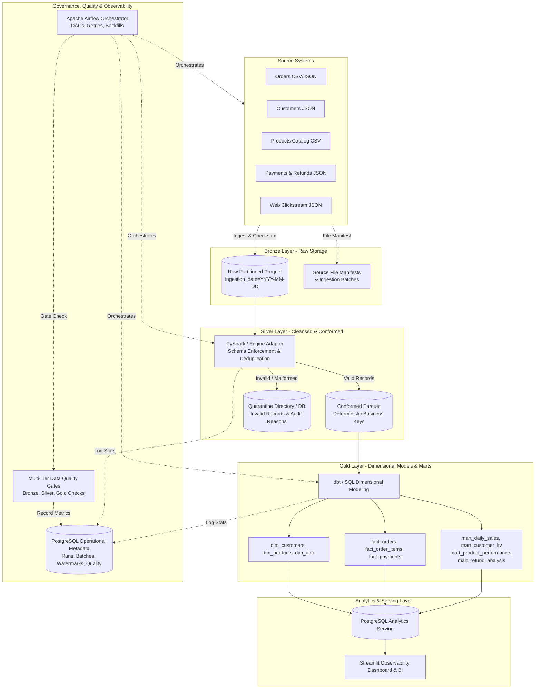
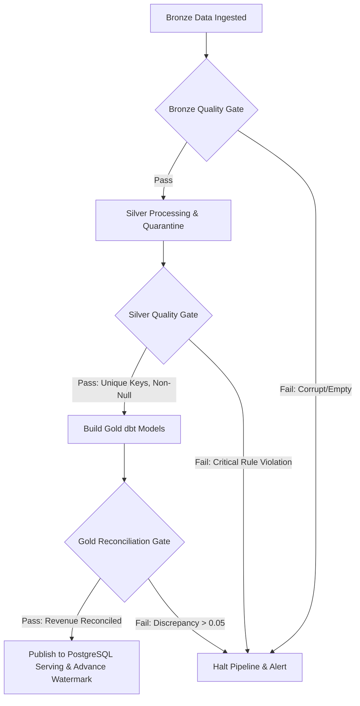

# Architecture Blueprint: Production-Style Data Lakehouse & ETL Platform

## 1. System Overview

The **Production-Style Data Lakehouse & ETL Platform** is an enterprise data engineering solution implementing the **Medallion Architecture (Bronze -> Silver -> Gold)** for high-volume e-commerce transaction and behavioral data. It bridges the gap between raw data lake storage (Parquet files) and operational data warehousing (dimensional star schema in PostgreSQL).

---

## 2. Storage Boundaries & Medallion Data Tiers

### 2.1 Bronze Layer (Raw Ingestion)
- **Physical Location:** `data/lakehouse/bronze/{entity}/ingestion_date=YYYY-MM-DD/{batch_id}_{filename}.parquet`
- **Design Philosophy:** Preserves raw payloads exactly as emitted by upstream systems. No destructive transformations or schema coercion.
- **Audit Lineage Columns Attached:**
  - `_ingestion_id`: Globally unique UUID identifying the ingestion event.
  - `_batch_id`: Batch correlation identifier.
  - `_source_name`: Ingesting source subsystem.
  - `_source_file`: Original filename.
  - `_source_file_checksum`: SHA-256 cryptographic digest of the source file to prevent duplicate file ingestion.
  - `_ingested_at`: UTC ISO timestamp when file was ingested.
  - `_source_record_id`: Natural identifier or file offset.

### 2.2 Silver Layer (Cleansed, Conformed, Deduplicated)
- **Physical Location:** `data/lakehouse/silver/{entity}/data.parquet`
- **Cleansing & Conforming Rules:**
  - Strict typing: UTC Timestamps, standardized currencies (ISO-4217), two-decimal precision monetary values (`DECIMAL(12, 2)` / `FLOAT64`).
  - Column name standardization: strictly lower snake_case.
  - Deterministic Business Key Deduplication: Partition by business key (`order_id`, `customer_id`, etc.), order by `updated_at DESC, _ingested_at DESC`, retaining rank 1.
  - Quarantine Isolation: Rows violating domain constraints (negative prices, null keys, invalid status codes) are routed to `data/lakehouse/quarantine/` and `metadata.quarantined_records`.
  - Schema Evolution: Tracks schema change events, accepting compatible new optional columns while quarantining or failing breaking changes.

### 2.3 Gold Layer (Dimensional Models & Analytical Marts)
- **Physical Location:** `data/lakehouse/gold/{table_name}/data.parquet` and PostgreSQL schema `gold`
- **Dimensional Modeling:**
  - Kimball Star Schema:
    - Dimensions: `dim_date`, `dim_customers`, `dim_products` (Surrogate keys: `date_key`, `customer_sk`, `product_sk`).
    - Facts: `fact_orders`, `fact_order_items`, `fact_payments` (Order grain, line item grain, payment grain).
  - Business Marts:
    - `mart_daily_sales`: Daily executive summary and margin reconciliation.
    - `mart_customer_lifetime_value`: Customer RFM and tenure segmentation.
    - `mart_product_performance`: Product-level margin percentage and return rates.
    - `mart_refund_analysis`: Payment method dispute and refund analysis.

---

## 3. Incremental Processing, Watermarks & Idempotency

### 3.1 Watermark Persistence
Incremental processing relies on persistent high watermarks stored in `metadata.watermarks`:
- `entity_name`: Target entity (`orders`, `customers`, etc.)
- `watermark_type`: `TIMESTAMP`
- `watermark_value`: ISO 8601 UTC timestamp of latest processed source data
- `last_batch_id`: Batch identifier advancing the watermark
- `updated_at`: Timestamp of checkpoint update

### 3.2 Overlapping Lookback Windows (Late-Arriving Events)
Upstream systems frequently generate delayed updates (e.g. status changes from `PROCESSING` to `SHIPPED` hours or days later).
To capture these updates without reprocessing the entire history, the platform computes an extraction window:
$$\text{Window Start} = \text{Watermark} - \text{Grace Period (e.g., 24 hours)}$$
$$\text{Window End} = \text{Current Execution Timestamp}$$

### 3.3 Safe Staging & Publish (Idempotency Guarantee)
Re-running a batch or pipeline run must never duplicate records or inflate metrics:
1. **Silver Parquet:** Staged write + deterministic window deduplication on `(business_key, updated_at DESC)`.
2. **PostgreSQL Serving:** `INSERT INTO gold... ON CONFLICT (order_sk) DO UPDATE...`
3. **Automated Testing:** `test_pipeline_idempotency_on_repeated_runs` verifies that processing the exact same batch produces identical row counts, identical gross revenue, and zero duplicate keys.

---

## 4. Automated Data Quality Barrier (Quality Gates)

The platform enforces automated quality checks at each medallion tier. If critical checks fail, the pipeline halts immediately, preventing invalid data from corrupting downstream Gold marts.

- **Bronze Checks:** File readability, Parquet format validation, non-empty row count, mandatory audit columns (`_ingestion_id`, `_batch_id`, `_source_file_checksum`).
- **Silver Checks:** Primary key uniqueness, non-null mandatory fields, non-negative monetary amounts, valid categorical statuses.
- **Gold Checks:** Surrogate key uniqueness in dimensions, fact-to-dimension referential integrity, financial revenue reconciliation ($\sum \text{fact\_orders.total\_amount} == \sum \text{mart\_daily\_sales.gross\_revenue}$).
