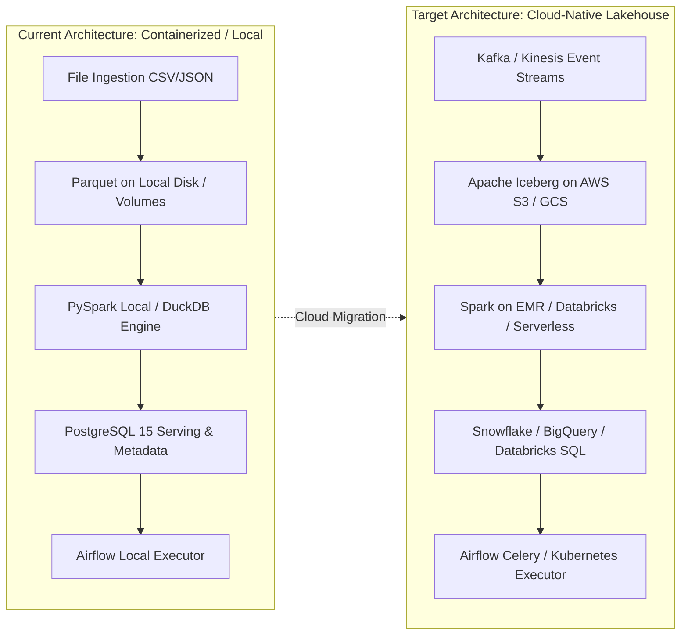

# Scaling & Cloud Migration Strategy: Enterprise Data Lakehouse

This document outlines the strategic roadmap for scaling the Data Lakehouse and ETL Platform from a single-node or local Docker container environment to an enterprise-grade cloud data architecture processing billions of records daily.

---

## 1. Architectural Scaling Roadmap



---

## 2. Storage Tier: Transitioning from Parquet to Apache Iceberg / Delta Lake

While raw Parquet partitioned files provide high-performance columnar reads, scaling to concurrent multi-writer enterprise workloads introduces challenges around transactional consistency, metadata overhead, and ACID guarantees.

### Recommended Open Table Format: **Apache Iceberg**
- **ACID Transactions:** Full snapshot isolation for concurrent readers and writers. Multiple ingestion pipelines can write to the Bronze/Silver tables simultaneously without conflicting or corrupting partitions.
- **Partition Evolution:** Partition layouts (e.g. changing from `ingestion_date=YYYY-MM-DD` to hourly `hour=HH`) can be modified without rewriting historical data files.
- **Hidden Partitioning:** Prevents downstream analytical queries from writing error-prone partition filter clauses (`date(order_timestamp) = '2026-03-01'` automatically leverages partition pruning).
- **Time Travel & Rollbacks:** Query historical table snapshots using `SELECT * FROM orders FOR SYSTEM_TIME AS OF '2026-03-01 12:00:00'`. Instantaneous zero-copy rollback if a bad ingestion batch escapes validation gates.

### Cloud Storage Strategy (AWS S3 / GCP GCS)
1. **Directory Layout:**
   - `s3://company-lakehouse-prod/bronze/<entity>/`
   - `s3://company-lakehouse-prod/silver/<entity>/`
   - `s3://company-lakehouse-prod/gold/<entity>/`
   - `s3://company-lakehouse-prod/quarantine/<entity>/`
2. **S3 Lifecycle Tiering:**
   - **Bronze:** Transition to S3 Infrequent Access (IA) after 30 days, and S3 Glacier Instant Retrieval after 90 days. Raw data is preserved for compliance and backfills at minimal storage cost.
   - **Silver & Gold:** Keep in S3 Standard for high-throughput query performance.

---

## 3. Compute Scaling: PySpark Distributed Tuning

### Moving to Cloud Spark (Amazon EMR / Google Dataproc / Databricks)
When dataset sizes exceed 100 GB, compute transitions from single-node instances to distributed Spark clusters.

### Spark Job Configuration Guidelines
| Spark Property | Development / Local | Cloud Production (Large) | Purpose |
|:---|:---|:---|:---|
| `spark.master` | `local[*]` | `yarn` or `k8s` | Cluster resource manager |
| `spark.executor.instances` | N/A | `20 - 100` (Auto-scaled) | Dynamic node allocation |
| `spark.executor.cores` | `4` | `4 - 5` | Optimal HDFS/S3 I/O concurrency |
| `spark.executor.memory` | `4g` | `16g - 32g` | Prevents OutOfMemory errors during joins |
| `spark.sql.shuffle.partitions` | `8` | `200 - 2000` | Tuned to target 128 MB per shuffle partition |
| `spark.sql.autoBroadcastJoinThreshold` | `10MB` | `64MB` | Broadcasts small dimension tables (`dim_products`, `dim_date`) |

### Mitigating the "Small Files Problem"
High-frequency micro-batches generate millions of tiny files, degrading cloud storage metadata performance.
- **Compaction Routine:** Scheduled nightly Airflow maintenance tasks trigger Iceberg compaction:
  ```sql
  CALL ice_catalog.system.rewrite_data_files(
    table => 'silver.orders',
    strategy => 'binpack',
    options => map('max-file-group-size-bytes', '536870912') -- 512 MB target
  );
  ```

---

## 4. Serving Layer Scaling: Modern Cloud Data Warehouses

While PostgreSQL is suitable for staging, operational metadata, and small-to-medium analytical serving (< 500 GB), enterprise analytics across millions of customers requires massively parallel processing (MPP).

### Warehouse Options
1. **Snowflake / Google BigQuery:**
   - External tables directly query the Parquet/Iceberg lakehouse files in S3/GCS.
   - Zero-copy clones for staging and testing environments.
   - Separate compute clusters for BI dashboards and batch transformation, eliminating resource contention.
2. **dbt Portability:**
   - Because our dbt models (`dbt_project/models/`) adhere to standard ANSI SQL and use KIMBALL dimensional staging/intermediate/marts conventions, migrating from `dbt-postgres` to `dbt-snowflake` or `dbt-bigquery` requires only updating `profiles.yml` with no changes to the business SQL logic.

---

## 5. Real-Time Streaming Evolution

To augment batch pipelines with real-time streaming for high-velocity clickstream and checkout events:


- **Ingestion:** Kafka or AWS Kinesis ingests clickstream JSON payloads with sub-second latency.
- **Micro-batch Processing:** Spark Structured Streaming writes raw streams into Bronze Iceberg tables using 30-second trigger intervals.
- **Dual-Path Architecture (Lambda/Kappa):** Real-time monitoring consumes from the streaming layer while daily reconciliations and heavy aggregations execute via scheduled Airflow DAGs.

---

## 6. FinOps & Cost Optimization

1. **Spot Instance Utilization:** Run batch Spark transformation and backfill jobs on AWS EC2 Spot instances or GCP Preemptible VMs (up to 70% cost savings). Graceful node decommissioning handles spot reclamation.
2. **Auto-Pause for BI Compute:** Configure data warehouse virtual warehouses to auto-suspend after 5 minutes of inactivity.
3. **Partition Pruning Enforcement:** Enforce mandatory date range filters on fact tables in downstream BI queries to avoid expensive full-table scans.
